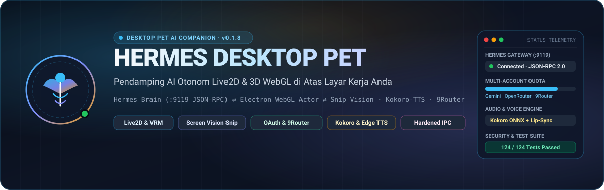
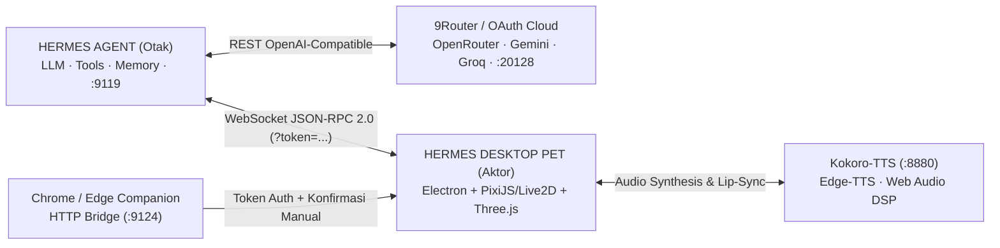
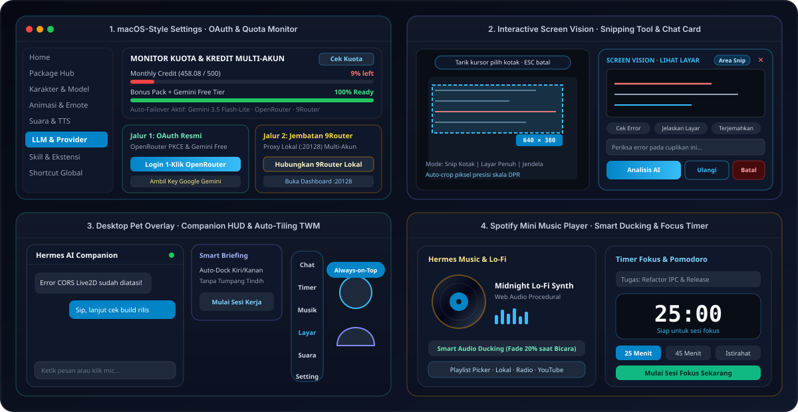

<!-- =========================================================================
     1. JUDUL PROYEK DAN BANNER (HEADER)
     ========================================================================= -->
<div align="center">


# Hermes Desktop Pet

**Pendamping AI Visual Interaktif (Live2D & 3D WebGL) yang Hidup di Atas Layar Kerja Anda**

[](https://github.com/KarmaSenzu/Hermes-Desktop-Pet/releases/latest)
[](LICENSE)
[](https://github.com/KarmaSenzu/Hermes-Desktop-Pet/actions/workflows/ci.yml)
[-10b981.svg?style=for-the-badge)](#7-panduan-instalasi-installation--setup)

[](https://www.electronjs.org/)
[](https://nodejs.org/)
[](https://pixijs.com/)
[](https://threejs.org/)
[-16a34a.svg)](#6-prasyarat-prerequisites)
[](CONTRIBUTING.md)

<br />



<br /><br />

[Unduh Rilis Terbaru](#-unduh-rilis-siap-pakai) · [Dokumentasi Arsitektur](docs/ARCHITECTURE.md) · [Spesifikasi API Bridge](docs/API_BRIDGE.md) · [Panduan Kontribusi](CONTRIBUTING.md) · [Laporkan Bug](https://github.com/KarmaSenzu/Hermes-Desktop-Pet/issues)

</div>

---

### Daftar Isi

1. [Judul Proyek dan Banner](#hermes-desktop-pet)
2. [Deskripsi Singkat dan Latar Belakang](#2-deskripsi-singkat-dan-latar-belakang)
3. [Tangkapan Layar & Visualisasi Antarmuka](#3-tangkapan-layar-screenshots--visual-showcase)
4. [Fitur Utama (Key Features)](#4-fitur-utama-key-features)
5. [Teknologi yang Digunakan (Tech Stack)](#5-teknologi-yang-digunakan-tech-stack)
6. [Prasyarat (Prerequisites)](#6-prasyarat-prerequisites)
7. [Panduan Instalasi (Installation & Setup)](#7-panduan-instalasi-installation--setup)
8. [Panduan Penggunaan (Usage)](#8-panduan-penggunaan-usage)
9. [Struktur Direktori (Directory Structure)](#9-struktur-direktori-directory-structure)
10. [Kontribusi dan Lisensi (Contributing & License)](#10-kontribusi-dan-lisensi-contributing--license)

---

## 2. Deskripsi Singkat dan Latar Belakang

**Hermes Desktop Pet** adalah aplikasi desktop lintas platform (*Windows, macOS, dan Linux*) yang menghadirkan asisten AI otonom dalam bentuk karakter **Live2D** maupun **3D (VRM/GLB/PMX/FBX)** di atas jendela kerja transparan (*always-on-top*, *click-through*). Proyek ini dirancang untuk mengatasi keterbatasan interaksi asisten AI tradisional yang terjebak di tab peramban web terpisah—membuat pengguna harus terus berpindah jendela hanya untuk bertanya, memeriksa error kode di layar, atau mengatur alur fokus kerja harian.

Dengan menerapkan arsitektur terpisah (*Decoupled Brain–Actor Architecture*), **Hermes Agent** berperan sebagai **Otak (*Brain*)** di balik layar untuk mengelola penalaran LLM, ingatan jangka panjang, dan eksekusi *tools* via WebSocket JSON-RPC (`:9119`), sementara aplikasi Electron ini bertindak sebagai **Aktor (*Actor*)** yang merender animasi ekspresif, memproses tangkapan layar (*Screen Vision Snipping*), memutar vokal neural + musik Lo-Fi, serta menjaga keamanan kredensial pengguna secara lokal. Karena merupakan aplikasi desktop *native*, Anda dapat langsung mencoba rilis jadinya melalui [**Halaman Rilis GitHub Resmi**](https://github.com/KarmaSenzu/Hermes-Desktop-Pet/releases/latest).



---

## 3. Tangkapan Layar (Screenshots / Visual Showcase)

<div align="center">
  
</div>

<br />

| Modul Antarmuka | Deskripsi Visual & Fungsionalitas Utama |
| :--- | :--- |
| **1. Pengaturan macOS-Style, Dual-Track OAuth & Quota Monitor** | Sidebar kiri yang terstruktur dengan panel kanan untuk login 1-klik **OpenRouter OAuth PKCE**, pengaturan **Google Gemini**, jembatan lokal **9Router**, serta pemantauan sisa kredit & *rate-limit* multi-akun ala *CreditBuddy*. |
| **2. Interactive Screen Vision (Snipping Tool) & Kartu Chat** | Panel pemilihan mode tangkapan (*Snip Kotak Area*, *Seluruh Layar*, atau *Pilih Jendela Aplikasi*), overlay potong layar berdimensi real-time, serta kartu pratinjau chat lengkap dengan tombol **Analisis AI**, **Tangkap Ulang**, dan **Batalkan**. |
| **3. Desktop Pet Overlay & Tiling Window Manager (TWM)** | Karakter Live2D/3D transparan tanpa bingkai (*frameless*) dilengkapi dock HUD vertikal dan penataan otomatis (*bilateral auto-tiling*) agar jendela Chat, Timer, dan Musik tersusun rapi tanpa saling menumpuk. |
| **4. Mini Music Player & Pomodoro Focus Timer** | Pemutar musik bernuansa *dark glassmorphism* dengan piringan vinyl berputar, equalizer, generator Lo-Fi Web Audio prosedural, *Smart Audio Ducking*, serta timer fokus interaktif. |

---

## 4. Fitur Utama (Key Features)

### 🎭 Karakter Live2D & 3D WebGL Adaptif
* Jendela *overlay* transparan tanpa bingkai (*always-on-top*) dengan dukungan tembus klik mouse (*click-through*) pada area kosong.
* Pelacakan kursor mata/kepala, gestur ekspresi dinamis berdasarkan emosi respons AI (*berpikir*, *menyapa*, *senang*, *fokus*), dan sinkronisasi bibir (*lip-sync*) otomatis saat berbicara.
* Mendukung impor model kustom pengguna dalam format `.model3.json` (Live2D), `.vrm`, `.glb`, `.gltf`, `.pmx`, `.pmd`, dan `.fbx` melalui protokol internal aman `model://`.

### 📸 Interactive Screen Vision & Snipping Tool
* **3 Mode Tangkapan Fleksibel:** Pengguna dapat bebas memilih **✂️ Snip Kotak Area** (*drag-to-crop* presisi berskala DPR dengan tombol `ESC` untuk batal), **🖥️ Seluruh Layar**, atau **🪟 Pilih Jendela Aplikasi Tertentu** lengkap dengan daftar pratinjau jendela yang sedang terbuka.
* **Kontrol Penuh di Kartu Chat:** Setiap hasil tangkapan layar pada kartu `📸 SCREEN VISION · LIHAT LAYAR` dilengkapi preset pertanyaan cepat (*Cek Error*, *Jelaskan Layar*, *Terjemahkan*), tombol **🔄 Tangkap Ulang (Retake)**, serta tombol **✕ / 🗑️ Batalkan** untuk membuang tangkapan yang salah dari riwayat chat.

### 🔐 Dual-Track AI Provider, OAuth PKCE & Auto-Failover
* **Jalur 1 — OAuth Resmi & Free Tier:** Login 1-klik via peramban untuk **OpenRouter (OAuth2 PKCE S256)** tanpa menyalin token manual, serta dukungan siap pakai untuk **Google Gemini (`gemini-3.5-flash-lite`)**, **Groq**, dan **Mistral**.
* **Jalur 2 — Jembatan 9Router Lokal (`:20128`):** Deteksi otomatis dan sinkronisasi konfigurasi untuk proxy 9Router multi-akun.
* **Smart Auto-Failover:** Secara otomatis berpindah ke provider cadangan yang valid jika provider utama mengalami batas kuota, antrean berlebih, atau *deprecation* (`HTTP 402 / 404 / 429 / 503`).

### 📊 Real-Time Multi-Account Quota Monitor
* Menampilkan ringkasan pemakaian kuota, sisa kredit bulanan, paket bonus aktif, jendela reset limit (5-jam / mingguan), dan status kredensial per akun pada panel *LLM & Provider*.

### 🎧 Produktivitas Terpadu (Musik Lo-Fi, Pomodoro & Briefing)
* **Hermes Music & Audio Ducking:** Mendukung *Playlist Picker* interaktif, *Procedural Lo-Fi Synthesizer* berbasis Web Audio API murni, berkas audio lokal, radio internet, serta peredupan volume otomatis ke 20% (*Smart Audio Ducking*) saat avatar sedang berbicara.
* **Timer Fokus & Pengingat Idle:** Timer Pomodoro yang bisa dikustomisasi durasinya, lengkap dengan pengingat postur/minum air berkala yang kalimat dan frekuensinya dapat diatur.
* **Drag & Drop File:** Tarik dan lepaskan berkas langsung ke tubuh avatar untuk langsung dianalisis bersama Hermes AI.

### 🗣️ Sintesis Vokal Neural Anime & 7 Core Skills Bawaan
* Mesin suara **Kokoro-TTS (`:8880`)** dengan normalisasi fonetik Bahasa Indonesia, dilengkapi fallback otomatis ke **`msedge-tts`**.
* Disertai 7 *core skills* siap sinkronisasi di direktori `skills/`: `mnemosyne` (memori SQLite), `duckduckgo-search`, `pdf`, `scrapling`, `weather-2-0`, `open-application`, dan `kokoro-tts`.

### 🛡️ Arsitektur Keamanan Berlapis (*Hardened Security*)
* **Origin-Bound Secret Sealing (`secret-store.js`):** Kunci API dienkripsi via Electron `safeStorage` (DPAPI/Keychain) dengan format `v2:` yang terikat pada origin server target—renderer tidak pernah memegang kredensial mentah.
* **Central IPC Policy & Sender Validation (`ipc-policy.js`, `secure-ipc.js`):** Pemisahan *preload* khusus (`avatar.js` & `settings.js`), validasi asal frame di setiap channel IPC, *Path-Guard* MIME/path traversal, *URL-Guard*, dan kebijakan *Strict CSP*.

---

## 5. Teknologi yang Digunakan (Tech Stack)

| Lapisan Sistem | Teknologi & Pustaka Utama | Versi | Fungsi Utama |
| :--- | :--- | :--- | :--- |
| **Desktop Shell & Bundler** | **Electron** · **electron-vite** · **electron-builder** | `45.1.0` · `2.3.0` · `26.18.0` | Jendela desktop transparan, IPC aman, bundling ESM, dan pengemasan installer lintas OS |
| **Runtime & Bahasa** | **Node.js (Pure ESM)** · **Vanilla JavaScript (ES2022+)** · **CSS3** | `>=24.0.0` | Logika proses utama & antarmuka ringan tanpa framework berat dan tanpa kompilasi C++ |
| **Grafis 2D & 3D WebGL** | **PixiJS** · **pixi-live2d-display** · **Three.js** · **@pixiv/three-vrm** | `6.5.10` · `0.4.0` · `0.170.0` · `3.3.0` | Rendering karakter Live2D Cubism serta model 3D VRM, GLTF/GLB, PMX, dan FBX |
| **AI Brain & Komunikasi** | **Hermes Agent (`hermes serve`)** · **ws (WebSocket)** · **yaml** | `ws 8.18.0` · `yaml 2.9.1` | Orkestrasi LLM, eksekusi *tools*, komunikasi JSON-RPC 2.0 (`:9119`), dan writer konfigurasi |
| **Sintesis Suara & Audio** | **Kokoro-ONNX** · **msedge-tts** · **Web Audio API** | `msedge-tts 1.2.0` | Vokal neural anime offline, TTS fallback cloud, equalizer, dan synthesizer Lo-Fi |
| **Keamanan & Pengujian** | **Electron `safeStorage`** · **Vitest** · **GitHub Actions** | `vitest 2.1.9` | Enkripsi kredensial tingkat OS, 20 *test suites* (124 unit test), dan CI lintas platform |

---

## 6. Prasyarat (Prerequisites)

### Perangkat Lunak Wajib & Opsional
* **Untuk Pengguna Akhir (Installer Biner):**
  * Sistem Operasi: Windows 10/11 (64-bit), macOS 11+ (Apple Silicon/Intel), atau Linux x64.
  * **Hermes Agent CLI** terpasang di sistem (`~/.hermes`) untuk layanan AI inti pada port `9119`.
* **Untuk Pengembang (Dari Kode Sumber):**
  * **Node.js:** Versi `>= 24.0.0` LTS (direkomendasikan jalur LTS aman bebas CVE seperti `v24.22.1`).
  * **NPM:** Versi `>= 10.x` (bawaan Node.js).
  * **Git:** Untuk kloning repositori.
  * **Python `3.10+` *(Opsional)*:** Hanya diperlukan jika ingin mengaktifkan server suara lokal **Kokoro-TTS** (`kokoro-onnx`, `soundfile`).
  * **Google Chrome / Microsoft Edge *(Opsional)*:** Jika ingin memasang ekstensi *Hermes Web Companion*.

### Spesifikasi Perangkat Keras

| Komponen | Spesifikasi Minimum | Spesifikasi Rekomendasi |
| :--- | :--- | :--- |
| **Prosesor (CPU)** | Intel Core i3 (Gen 8+) / AMD Ryzen 3 / Apple M1 | Intel Core i5/i7 (Gen 10+) / AMD Ryzen 5/7 / Apple M2+ |
| **Memori (RAM)** | 8 GB RAM | 16 GB RAM (nyaman untuk multitasking WebGL + IDE) |
| **Kartu Grafis (GPU)** | Integrated GPU (Intel Iris Xe / UHD / Radeon Vega) | Dedicated GPU (NVIDIA GTX/RTX) atau Apple Silicon GPU |
| **Penyimpanan** | 1.5 GB ruang disk kosong | SSD NVMe (ditambah ~340 MB jika memakai model Kokoro-ONNX) |

---

## 7. Panduan Instalasi (Installation & Setup)

### Opsi A: Unduh & Instal Cepat (Untuk Pengguna Akhir)

<a id="-unduh-rilis-siap-pakai"></a>

| Sistem Operasi | Arsitektur | Paket Rilis Resmi | Pembaruan Cepat (Terminal) |
| :--- | :--- | :---: | :--- |
| 🍏 **macOS** | Apple Silicon (ARM64) & Intel | [**Download `.dmg` / `.zip`**](https://github.com/KarmaSenzu/Hermes-Desktop-Pet/releases/latest) | `curl -fsSL https://raw.githubusercontent.com/KarmaSenzu/Hermes-Desktop-Pet/main/update.sh \| bash` |
| 🪟 **Windows 10/11** | 64-bit (NSIS Setup / Portable) | [**Download `.exe` / `.zip`**](https://github.com/KarmaSenzu/Hermes-Desktop-Pet/releases/latest) | `irm https://raw.githubusercontent.com/KarmaSenzu/Hermes-Desktop-Pet/main/update.ps1 \| iex` |
| 🐧 **Linux** | x86_64 (Universal) | [**Download `.AppImage` / `.tar.gz`**](https://github.com/KarmaSenzu/Hermes-Desktop-Pet/releases/latest) | `curl -fsSL https://raw.githubusercontent.com/KarmaSenzu/Hermes-Desktop-Pet/main/update.sh \| bash` |

> **Pemasangan Satu Baris (macOS & Linux):**
> ```bash
> curl -fsSL https://raw.githubusercontent.com/KarmaSenzu/Hermes-Desktop-Pet/main/install.sh | bash
> ```

<details>
<summary><strong>Catatan Penting macOS Gatekeeper & Windows SmartScreen</strong></summary>

* **macOS ("Aplikasi rusak dan tidak dapat dibuka"):** Karena rilis komunitas belum memakai sertifikat berbayar Apple Developer ID, hapus atribut karantina sekali saja via Terminal:
  ```bash
  xattr -cr "/Applications/Hermes Desktop Pet.app"
  ```
* **Windows SmartScreen:** Jika muncul layar *"Windows protected your PC"*, klik **More info** → **Run anyway**.

</details>

---

### Opsi B: Menjalankan dari Kode Sumber (Untuk Pengembang)

#### 1. Kloning Repositori & Masuk ke Direktori Aplikasi
```bash
git clone https://github.com/KarmaSenzu/Hermes-Desktop-Pet.git
cd Hermes-Desktop-Pet/avatar
```

#### 2. Instalasi Dependensi NPM
Proyek ini bebas dari ketergantungan native C++ (*Pure JavaScript / WebGL*), sehingga tidak membutuhkan Visual Studio Build Tools maupun `node-gyp`.
```bash
npm install
```

#### 3. Pengaturan Environment & Layanan Hermes
Aplikasi membaca konfigurasi LLM/TTS/STT dari `~/.hermes/config.yaml`, variabel lingkungan `~/.hermes/.env`, serta menyimpan token sesi gateway secara aman di `~/.hermes-avatar/`. Contoh konfigurasi dapat dilihat pada [docs/CONFIG_EXAMPLE.md](docs/CONFIG_EXAMPLE.md).
```bash
# Opsional: jalankan layanan Hermes secara terpisah jika belum auto-spawn
hermes serve
```

#### 4. Diagnosa Kesehatan Sistem & Jalankan Unit Test
```bash
# Verifikasi kesiapan Node.js, dependensi, model Live2D, 7 Core Skills, dan port layanan
npm run doctor

# Jalankan seluruh rangkaian unit test (20 suite / 124 tes)
npm test
```

#### 5. Menjalankan Aplikasi (Mode Pengembangan / Build Produksi)
```bash
# Mode pengembangan (Electron + Vite Hot Reload)
npm run dev

# Atau kompilasi bundle produksi & jalankan preview
npm run build
npm run start
```

#### 6. Komponen Ekstra Opsional (Kokoro-TTS & Ekstensi Browser)
<details>
<summary><strong>Klik untuk melihat langkah instalasi Kokoro-TTS Lokal & Ekstensi Chrome/Edge</strong></summary>

1. **Kokoro-TTS Lokal (Port `8880`):**
   ```bash
   # Windows
   py -m pip install kokoro-onnx soundfile

   # macOS / Linux
   python3 -m pip install kokoro-onnx soundfile --break-system-packages
   ```
   Setelah terpasang, buka **Pengaturan → Package Hub → Kokoro-TTS Engine** dan klik jalankan server. Model ONNX (~340 MB) akan diunduh otomatis pada penggunaan perdana.
2. **Hermes Web Companion (Chrome / Edge):**
   * Buka `chrome://extensions` (atau `edge://extensions`) dan aktifkan **Developer mode**.
   * Klik **Load unpacked**, lalu arahkan ke folder `extensions/chrome` di dalam repositori (atau `%USERPROFILE%\.hermes-avatar\extensions\chrome` / `~/.hermes-avatar/extensions/chrome`).
   * Blok teks di halaman web mana pun lalu tekan <kbd>Alt</kbd> + <kbd>A</kbd> untuk mengirim konteks ke avatar.

</details>

---

## 8. Panduan Penggunaan (Usage)

### 1. Memulai Layanan & Mengatur Koneksi AI
Aplikasi ini **tidak menggunakan login username/password dummy lokal**. Saat jendela **Launcher / Settings** terbuka pertama kali, pilih salah satu jalur akses AI resmi pada tab **LLM & Provider**:

* **Jalur 1 — OAuth Resmi & Free Tier (Direkomendasikan):**
  * Klik **Login 1-Klik OpenRouter (OAuth Gratis)** untuk otorisasi PKCE aman lewat browser tanpa menyalin API key manual, **atau**
  * Masukkan API key **Google Gemini** (`gemini-3.5-flash-lite`), **Groq**, atau **Mistral** (kunci dienkripsi otomatis dengan OS `safeStorage`).
* **Jalur 2 — Jembatan 9Router Lokal (Opsional):**
  * Jika Anda menjalankan proxy 9Router pada `http://127.0.0.1:20128/v1`, klik **Hubungkan Instan ke 9Router Lokal** untuk mendeteksi daftar model dan memantau sisa kuota tiap akun.

Klik tombol **Mulai Avatar** pada Launcher untuk memunculkan karakter di desktop (aplikasi akan memeriksa kesiapan layanan melalui *Smart Prerequisites Check*).

### 2. Mengoperasikan Companion HUD & Fitur Utama
Arahkan kursor ke karakter untuk memunculkan tombol **HUD Vertikal** di samping avatar:

* **💬 Chat & Suara (`🎤`):** Buka jendela percakapan mengambang untuk berdiskusi, mengirim perintah cepat (misalnya *"mulai fokus 25 menit"*, *"putar musik"*, *"lihat layarku"*), atau berbicara langsung lewat mikrofon.
* **📸 Layar (Screen Vision & Snipping Tool):**
  1. Klik **📸 Layar** pada HUD untuk membuka modal pilihan mode tangkapan.
  2. Pilih **✂️ Pilih Kotak Area (Snip)** untuk menarik kotak area tertentu di layar (tekan <kbd>ESC</kbd> untuk batal), **🖥️ Seluruh Layar**, atau klik langsung salah satu **🪟 Jendela Aplikasi Aktif**.
  3. Pada kartu pratinjau di chat, pilih pertanyaan cepat atau ketik instruksi Anda, lalu klik **🚀 Analisis dengan Hermes AI**. Jika tangkapan salah, gunakan **🔄 Tangkap Ulang** atau **🗑️ Batalkan** (`✕`).
* **⏱️ Timer & 🎵 Musik:** Mulai sesi Pomodoro dengan catatan tugas kustom, atau buka pemutar musik Lo-Fi dengan kontrol *Playlist Picker* dan *Smart Audio Ducking*.
* **📂 Drag & Drop Berkas:** Seret file teks, log, atau kode langsung ke atas tubuh avatar untuk segera dianalisis di jendela chat.

### 3. Pintasan Global Bawaan (*Global Shortcuts*)
Semua pintasan berikut bekerja meski Anda sedang berada di aplikasi lain dan dapat diubah melalui menu **Shortcut Global** di Pengaturan:

| Aksi | Pintasan Default (Windows / Linux) | Pintasan Default (macOS) |
| :--- | :---: | :---: |
| **Buka / Tutup Jendela Chat** | <kbd>Ctrl</kbd> + <kbd>Shift</kbd> + <kbd>Space</kbd> | <kbd>Cmd</kbd> + <kbd>Shift</kbd> + <kbd>Space</kbd> |
| **Mulai / Hentikan Rekam Suara (Mic)** | <kbd>Ctrl</kbd> + <kbd>Shift</kbd> + <kbd>M</kbd> | <kbd>Cmd</kbd> + <kbd>Shift</kbd> + <kbd>M</kbd> |
| **Buka Jendela Pengaturan (Settings)** | <kbd>Ctrl</kbd> + <kbd>Shift</kbd> + <kbd>S</kbd> | <kbd>Cmd</kbd> + <kbd>Shift</kbd> + <kbd>S</kbd> |

---

## 9. Struktur Direktori (Directory Structure)

```text
Hermes-Desktop-Pet/
├── .github/
│   └── workflows/
│       ├── ci.yml                        # CI Pipeline (Vitest + Build + Doctor di Win/Linux)
│       └── release.yml                   # Multi-Platform Release Build (Tag v*)
├── avatar/                               # Aplikasi Desktop Inti (Electron + Pure ESM)
│   ├── assets/
│   │   ├── audio/                        # Sampel & cache audio lokal
│   │   ├── default-skills/               # Salinan portabel 7 core skills bawaan
│   │   ├── icons/                        # Ikon aplikasi & UI
│   │   ├── live2d/                       # Aset model Live2D Cubism bawaan
│   │   └── models/                       # Direktori model 3D kustom pengguna (.vrm/.glb)
│   ├── build/                            # Ikon rilis lintas OS (.ico, .icns, .png)
│   ├── scripts/
│   │   ├── doctor.mjs                    # Skrip diagnosa sistem (npm run doctor)
│   │   ├── kokoro_server.py              # Layanan HTTP Kokoro-TTS lokal (:8880)
│   │   └── app_launcher.py               # Helper peluncur aplikasi desktop
│   ├── src/
│   │   ├── main/                         # Proses Utama Electron (Node.js ESM)
│   │   │   ├── index.js                  # Entry point, window manager, protokol model://, Screen Vision
│   │   │   ├── hermes-gateway.js         # Klien WebSocket JSON-RPC 2.0 (:9119)
│   │   │   ├── service-manager.js        # Auto-spawn hermes serve & manajemen port
│   │   │   ├── oauth-service.js          # Alur OAuth2 PKCE (OpenRouter) & quota monitor
│   │   │   ├── provider-service.js       # Pengujian koneksi, normalisasi model Gemini & failover
│   │   │   ├── secret-store.js           # Penyegelan rahasia origin-bound via safeStorage (v2)
│   │   │   ├── secure-ipc.js             # Wrapper validasi sender/origin untuk semua handler IPC
│   │   │   ├── ipc-policy.js             # Whitelist channel IPC per window & RPC methods
│   │   │   ├── path-guard.js             # Penjagaan akses direktori & verifikasi MIME
│   │   │   ├── path-resolver.js          # Deteksi otomatis path CLI, model, & kuota 9Router
│   │   │   ├── url-guard.js              # Validasi protokol HTTP/HTTPS & deteksi loopback
│   │   │   ├── hermes-config.js          # Writer non-destruktif ~/.hermes/config.yaml & .env
│   │   │   ├── bridge-server.js          # Server HTTP bridge ekstensi browser (:9124)
│   │   │   ├── bridge-token.js           # Pembuat & validator token otentikasi bridge
│   │   │   ├── app-registry.js           # Registri aplikasi aman berbasis ID tervalidasi
│   │   │   ├── actions.js                # Pemetaan aksi terminal terstruktur
│   │   │   ├── tts-service.js            # Layanan sintesis vokal (Hermes / Kokoro / Edge-TTS)
│   │   │   ├── updater-service.js        # Layanan OTA update & verifikasi checksum rilis
│   │   │   ├── feed-service.js           # Pengambil data cuaca & berita langsung
│   │   │   ├── cli-args.js               # Sanitizer argumen eksekusi proses anak
│   │   │   ├── png-size.js               # Pembaca dimensi PNG & estimasi VRAM tekstur
│   │   │   └── shortcuts.js              # Manajemen pintasan global OS
│   │   ├── preload/                      # Jembatan IPC terisolasi (Context Isolation)
│   │   │   ├── avatar.js                 # Preload khusus jendela avatar (window.hermesAvatar)
│   │   │   └── settings.js               # Preload khusus jendela launcher & settings
│   │   └── renderer/                     # Antarmuka WebGL & UI (index, launcher, settings)
│   │       ├── index.html                # Overlay avatar, HUD, chat, modal snipping & timer
│   │       ├── launcher.html             # Halaman launcher & pemeriksaan prasyarat
│   │       ├── settings.html             # Pusat pengaturan bergaya macOS System Settings
│   │       ├── js/
│   │       │   ├── main.js               # Orkestrasi avatar, chat, Snip Tool, & widget
│   │       │   ├── widget-controller.js  # Parser perintah cepat & kartu interaktif chat
│   │       │   ├── live2d-avatar.js      # Engine PixiJS + Live2D Cubism + lip-sync
│   │       │   ├── desktop-pet.js        # Engine Three.js untuk karakter 3D VRM/GLB/PMX
│   │       │   ├── hermes-client.js      # Klien event streaming chat & rekaman suara
│   │       │   ├── tiling-manager.js     # Tiling Window Manager bilateral otomatis
│   │       │   ├── music-player.js       # Pemutar musik, Lo-Fi synth, & audio ducking
│   │       │   ├── pomodoro-timer.js     # Pengelola sesi fokus & pengingat idle
│   │       │   ├── settings.js           # Kontroler utama panel pengaturan
│   │       │   ├── settings-animations.js# Panel konfigurasi pose & animasi karakter
│   │       │   ├── settings-apps.js      # Panel peluncur aplikasi & perintah cepat
│   │       │   ├── settings-music.js     # Panel pustaka musik & pengaturan Lo-Fi
│   │       │   ├── settings-shortcuts.js # Panel kustomisasi shortcut global
│   │       │   └── ...                   # Modul markdown, deteksi emosi, TTS, & toast
│   │       └── styles/                   # Stylesheet terpusat (main.css & launcher.css)
│   ├── tests/                            # 20 file unit test Vitest (124 kasus uji)
│   ├── csp-policy.js                     # Definisi aturan Content Security Policy
│   ├── electron.vite.config.js           # Konfigurasi build Vite untuk main/preload/renderer
│   └── package.json                      # Manifes dependensi & skrip build
├── docs/                                 # Dokumentasi Teknis & Aset Visual
│   ├── assets/                           # Banner SVG & showcase visual antarmuka
│   ├── ARCHITECTURE.md                   # Penjelasan mendalam arsitektur Brain–Actor
│   ├── API_BRIDGE.md                     # Spesifikasi protokol WebSocket JSON-RPC
│   ├── DEVELOPMENT_STANDARDS.md          # Standar kode, token desain, & aturan wajib
│   ├── SETTINGS_STRUCTURE.md             # Dokumentasi arsitektur panel Settings
│   └── ROADMAP.md                        # Peta jalan pengembangan
├── extensions/chrome/                    # Kode sumber ekstensi Web Companion (Manifest V3)
├── skills/                               # 7 Core Skills otonom Hermes Agent
├── CONTRIBUTING.md                       # Panduan kontribusi repositori
├── LICENSE                               # Berkas lisensi terbuka MIT
└── README.md                             # Dokumentasi utama proyek
```

---

## 10. Kontribusi dan Lisensi (Contributing & License)

### Tata Cara Kontribusi
Kontribusi berupa perbaikan bug, peningkatan UI, maupun penambahan skill sangat terbuka bagi komunitas. Sebelum mengirimkan *Pull Request*, harap patuhi ketentuan berikut:
1. Gunakan format **Conventional Commits** berbahasa Inggris pada pesan komit (contoh: `feat(avatar): ...`, `fix(settings): ...`, `docs(readme): ...`).
2. Pertahankan arsitektur **Pure ESM** (`import`/`export`), indentasi **2 spasi** untuk berkas JavaScript/HTML/CSS, dan jangan menambahkan framework SPA eksternal (React/Vue) maupun menyimpan kredensial di `localStorage`.
3. Pastikan seluruh pemeriksaan berikut lulus tanpa galat sebelum mengajukan PR:
   ```bash
   cd avatar
   npm test
   npm run build
   npm run doctor
   ```
4. Baca panduan lengkap kontributor di [CONTRIBUTING.md](CONTRIBUTING.md) dan [docs/DEVELOPMENT_STANDARDS.md](docs/DEVELOPMENT_STANDARDS.md).

### Lisensi & Atribusi Aset (*Split License*)
Proyek ini menerapkan lisensi terpisah antara kode sumber program dan aset multimedia bawaan:

* **Kode Sumber Perangkat Lunak:** Dilisensikan secara terbuka di bawah [**MIT License**](LICENSE). Anda bebas mempelajari, memodifikasi, dan mendistribusikan ulang kode sumber dengan tetap menyertakan pemberitahuan lisensi asli.
* **Aset Model Karakter & Sampel Audio Bawaan (*"Mother"*):** Disediakan secara eksklusif di bawah **Lisensi Non-Komersial (Non-Commercial / Fan Tribute)**.
  * Aset karakter merupakan bentuk apresiasi terhadap game indie di platform Steam: [**Your Mother (Steam App ID: 3399950)**](https://store.steampowered.com/app/3399950/Your_Mother/).
  * Hanya diperuntukkan bagi pembelajaran pemrograman, eksperimen AI, dan penggunaan pribadi. **Dilarang keras mengomersialkan atau memperjualbelikan aset karakter tersebut dalam bentuk apa pun.**
* **Model Kustom Pengguna:** Model 3D (`.vrm`/`.glb`/`.pmx`) atau Live2D pihak ketiga yang Anda pasang sendiri tunduk pada lisensi kreator masing-masing.

### Kontak Pengembang & Dukungan
* **Pengelola Proyek:** [**KarmaSenzu**](https://github.com/KarmaSenzu)
* **Repositori GitHub:** [KarmaSenzu/Hermes-Desktop-Pet](https://github.com/KarmaSenzu/Hermes-Desktop-Pet)
* **Pelaporan Masalah & Permintaan Fitur:** [GitHub Issues](https://github.com/KarmaSenzu/Hermes-Desktop-Pet/issues)

<div align="center">
  <br />
  <sub>Dibangun dengan arsitektur desktop transparan untuk menghadirkan pengalaman pendamping AI yang hidup dan aman.</sub>
</div>
